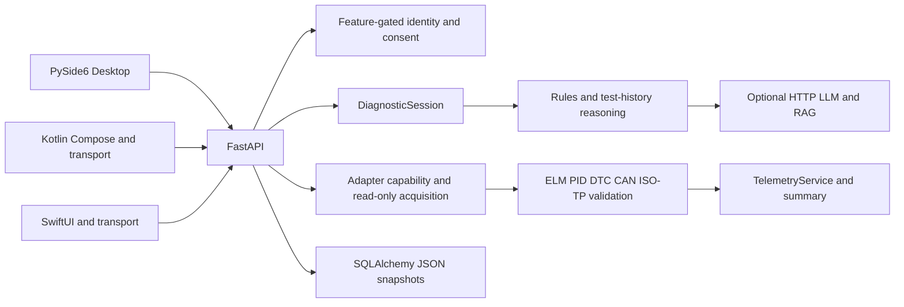

# Current Architecture

Date: 2026-10-29 (Asia/Yerevan). Repository: `Grigor1995/AI-CAR-SCANER`.

Entrypoints: root runner.py; finalbuild/apps/desktop/main.py; backend worker;
backend/api/main.py; Android MainActivity.kt; iOS AICarScannerApp.swift.
Clients keep native UI/transport responsibilities. Backend owns polling plans,
PID decoding, telemetry and diagnostic decisions. Legacy API state owns local
sessions; optional SQLAlchemy snapshot persistence serializes whole sessions.
Ecosystem v2 adds durable owner/consent boundaries with separate migration metadata.

TelemetryService currently retains an unbounded in-memory list per session.
Summary snapshots/sorts samples, groups signals, computes statistics/events and
serializes Pydantic models. No persistence or retention policy is silently added.
Long-running retention, summary pagination and incremental event accumulation
need explicit API/lifecycle design before implementation.

Actual duplicated processing: sorted/filter passes in stats and event paths.
Potential coupling: Desktop ui.py owns many presentation/coordinator actions;
legacy sessions registry and persistence middleware; backend/vehicle/isotp is a
minimal stub while finalbuild/vehicle/isotp contains the actual stack. This audit
does not substitute the stub or remove either implementation.
GlobalDataStore rereads JSON; lexical RAG scans documents and sorts hits. These
are candidates for invalidation-aware indexing, not evidence of current latency.
Transport waits, discovery and model generation remain distinct from CPU decoding.
