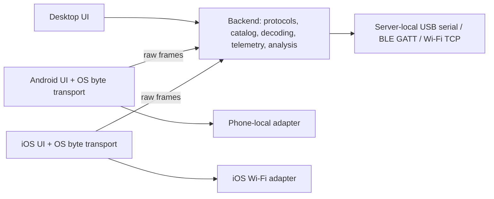

# Real OBD audit, vehicle references and backend ownership

Audit date: 2026-10-22. Baseline: `b74a8eb`.

## Findings and changes

The public backend device facade previously exposed only a deterministic
simulator, while usable USB-serial, BLE-GATT and Wi-Fi TCP transports existed
in `vehicle/`. The facade now delegates physical devices to that runtime.
The Wi-Fi descriptor spelling `Wi-Fi` also failed the runtime's `WIFI` branch;
this is fixed and covered by a real loopback TCP transport integration test.

Android previously contained its own ten PID formulas and initialization
commands. These are now backend-owned. Android executes the returned plan,
forwards raw frames and renders decoded values. iOS has the same API contract
and a native TCP byte bridge with timeouts/cancellation; its BLE implementation
still provides discovery only. Desktop uses backend device APIs and shared
backend decoding. Native USB/Bluetooth permissions and byte IO stay native.



Physical acquisition can use a connected server-local device rather than a
simulator. Native snapshots with an internal session_id feed the same backend
telemetry/acquisition services. Concurrent native and server-local streams for
the same session are rejected instead of mixing readings. Switching between
simulator history and real measurements requires a new session; simulator
telemetry is explicitly tagged SIMULATOR. Physical read errors
stop acquisition with ERROR; no simulated values replace failed real readings.

ELM parsing now preserves reply boundaries, handles compact/echoed replies,
11-/29-bit CAN headers and ISO-TP sequences, and rejects wrong PID/service,
truncation and invalid hex instead of returning the last two unrelated bytes.
Automatic link negotiation gets a bounded 35-second initialization window
before normal PID polling. Commands are serialized. Prompt timeouts close native transports; Python
transport failures disconnect before another command can consume a late reply.
Stored, pending and permanent DTC reads use Modes 03/07/0A. Supported-PID
bitmaps can be read page by page. Acquisition records are bounded to 5,000 for
physical/native streams.

## Protocol support matrix

The adapter implements the physical bus; implementing an ELM command does not
mean this application independently drives K-line/J1850 electrical signaling.

| Family | ELM selection | Application support |
|---|---|---|
| Automatic detection | 0 | Preferred default; trigger 0100, then inspect ATDPN |
| SAE J1850 PWM, 41.6 kbit/s | 1 | ELM adapter selection and generic OBD reply decoding |
| SAE J1850 VPW, 10.4 kbit/s | 2 | Same |
| ISO 9141-2, 10.4 kbit/s | 3 | Same; adapter handles link headers/checksum |
| ISO 14230-4 KWP, 5-baud init | 4 | Same |
| ISO 14230-4 KWP, fast init | 5 | Same |
| ISO 15765-4 CAN 11-bit / 500 kbit/s | 6 | Same; CAN framing/ISO-TP reply parsing covered |
| ISO 15765-4 CAN 29-bit / 500 kbit/s | 7 | Same |
| ISO 15765-4 CAN 11-bit / 250 kbit/s | 8 | Same |
| ISO 15765-4 CAN 29-bit / 250 kbit/s | 9 | Same |
| SAE J1939 | A | Registry documents it; generic reader rejects selection because no J1939 PGN/SPN decoder is implemented |
| ISO 14229 UDS over ISO-TP | Separate read-oriented library | Physical UDS API remains unimplemented; existing UDS HTTP runtime is explicitly simulator-only |
| ISO 13400 DoIP | None | Not implemented |
| CAN FD / ISO 15765-2 FD transport | None | Not implemented |
| ISO 27145 WWH-OBD | None | Not implemented |
| SAE J1708/J1587 | None | Not implemented |
| OBD-I / manufacturer-specific enhanced diagnostics | None | Requires a documented manufacturer driver/profile; no universal support claim |

Clear-DTC, actuator tests, security access, coding and programming are not
provided by the new read-only plan. ELM USER1/USER2 configurations are custom
adapter settings, not extra universally supported vehicle protocols.

A model name, engine family or VIN prefix cannot confirm the actual protocol.
The compatibility API returns candidates and requires adapter detection.
The US model-year 2008+ CAN rule narrows candidates only when the caller supplies
market=US. Other markets/earlier vehicles remain unknown. No vehicle profile is
marked observed or confirmed from that regulatory inference.

## Vehicle and image data

`data/vehicle_reference.json` contains **50 generation references / 147 engine
options**, with petrol, diesel and hybrid types and Wikipedia article links.
These are curated reference entries, not a live Wikipedia engine extraction.
Article/engine facts have not been live reverified here. Generation year spans
are selector candidates: not every engine was available in every listed year,
market, transmission or trim. Entries explicitly carry
`generation-reference-not-vin-fitment` and fitment_verified=false. ECU names
are left unknown. Native forms bind server fuel defaults and show the fitment
notice; diesel/hybrid selections do not inherit petrol/LPG checkbox values.

The existing strict catalog resolve endpoint remains database-backed. Broader
reference candidates are merged into selector entries and selector lists; they
are also available when the catalog database is unavailable. This fallback
never turns those candidates into verified fitment rows or overwrites user
catalog data. Database-dependent failures remain visible on strict resolution.

All clients can request images from the backend. Existing generated PNGs are
retained as offline caches and explicitly identified as illustrations. No old
image is reused for an unrelated model. New models without an imported photo
have an unavailable image rather than a fabricated vehicle photo.

The Commons importer resolves the article page image, retrieves source/creator/
license, rejects unsupported or missing licenses, validates the download host
and raster size, converts to WebP and atomically updates a manifest. Attribution
is exposed with the catalog/image response and retained in the manifest.
Desktop shows photo credit in a tooltip; Android/iOS expose the source link.

**External access limitation:** actual Wikipedia/Commons requests on this host
returned `Tunnel connection failed: 403 Forbidden`. A one-vehicle import was
attempted and failed explicitly. **Zero new Commons photos were downloaded.**
The importer was tested with raster/metadata fixtures; those are not claimed
as actual downloaded vehicle photos. The bundled generated portraits remain.

## Sources and validation boundaries

- ELM327 command documentation: https://www.elmelectronics.com/wp-content/uploads/2016/07/ELM327DS.pdf
- Independently reviewed protocol selection facts from python-OBD commit
  `a378bdd81d58c67d08050e4244173a9a7dbda73d`:
  https://github.com/brendan-w/python-OBD/tree/a378bdd81d58c67d08050e4244173a9a7dbda73d/obd/protocols
- Vehicle-specific research references are stored in each catalog record.
- Photos imported later must retain their Commons creator/license/source and
  any applicable attribution/share-alike obligations.

There has been no physical vehicle, oscilloscope, J2534 vendor DLL, BLE-GATT or
USB device validation on this host. The loopback ELM server exercises real TCP
IO and backend routing, not vehicle hardware or all electrical protocols.
Native iOS additions require Xcode typechecking/XCTest/device confirmation;
Swift parsing alone does not establish native compatibility.

## Executed validation (2026-10-22)

| Check | Result |
|---|---|
| Root Python regression suite | 666 passed, 2 skipped |
| New OBD/reference/import APIs and ELM parser coverage | 95.69%, 90% gate passed |
| Isolated Desktop regression matrix | 386 passed, 1 skipped; all five groups passed |
| Desktop combined / production-core coverage | 90.36% / 91.33%; both 90% gates passed |
| Actual FastAPI source process startup | Passed |
| Android unified builder, debug APK and JVM tests | Passed; 91 JVM cases, zero failures |
| Android instrumentation source compilation | Passed; no emulator/device tests executed |
| Android lint | Zero errors, 13 warnings |
| iOS Swift syntax parsing | Passed for 12 files; Xcode build/XCTest not executed |
| Commons live photo import | Blocked by HTTP 403; zero new photos |

Reproduce Python checks from the repository root:

```bash
python -m pytest -q --cov=obd --cov=catalog_sources --cov=api.obd_routes --cov=api.vehicle_reference_routes --cov=vehicle.obd.protocols.elm327 --cov-fail-under=90
```

From `finalbuild/`:

```bash
python scripts/run_desktop_tests.py --min-coverage 90 --min-core-coverage 90
python scripts/test_fastapi_startup.py --mode source
```

The root and Desktop suites overlap; their counts must not be summed as unique
cases. Coverage above is scoped to the named modules, not all vehicle protocols.
The generated Android debug APK was 53,872,454 bytes with SHA-256
`f53df634896cdaf7baa01dab502054c743d116a32e07967e5c7d8771c8fdada3`.
This is a local validation artifact, not a published release binary.
